<div align="center">

# B.M.S. COLLEGE OF ENGINEERING, BENGALURU
### (Autonomous Institute, Affiliated to VTU)
### Department of Machine Learning

<br>

## Alternative Assessment Tool (AAT)
### Statistical Modeling (24AM5PCSML)
### Academic Year 2026–2027

<br>

# Crop Yield Prediction Using Statistical Modeling and Machine Learning

**Problem domain:** Agriculture and Predictive Analytics
**Target variable:** Crop yield (tonnes per hectare)
**SDG addressed:** SDG 2 – Zero Hunger

<br>

| | |
|---|---|
| Submitted by | _Name_ — _USN_ |
| Semester / Section | _5th Semester, Section __ |
| Submitted to | _Faculty name, Designation_ |
| Date of submission | _DD / MM / 2026_ |

</div>

---

## Table of Contents

1. Cover Page
2. Table of Contents
3. Problem Identification
4. Dataset Selection
5. Exploratory Data Analysis
6. Simple Linear Regression
7. Multiple Linear Regression
8. Regression Assumption Testing
9. Estimator Validation
10. Phase 1 Results
11. Feature Selection
12. Ridge and LASSO Regression
13. Machine Learning Model Development
14. Model Evaluation
15. Comparative Analysis
16. Final Model Selection
17. Real-World Interpretation
18. Final Results
19. SDG Mapping and Justification
20. Conclusion
21. References
- Appendix A: Reproducing the results
- Appendix B: Output files

> **Note on numbers.** Every statistic in this report was produced by running
> `src/crop_yield_pipeline.py` (seed = 42). The full console output is in `outputs/run_log.txt`, every
> number is also stored in `outputs/results.json`, and all figures are in `outputs/figures/`. No value
> has been typed in by hand or estimated.

---

# PHASE 1: STATISTICAL MODEL DEVELOPMENT AND VALIDATION

## 3. Problem Identification

### 3.1 The agricultural problem
Crop yield is the amount of crop harvested per unit of land (here, tonnes per hectare). It changes from
country to country and year to year. The main causes are the crop grown, the climate (temperature and
rainfall), inputs such as pesticides and fertiliser, and technology and management, which improve over
time. Governments, food agencies and farmers have to make decisions about planting, imports, storage,
input supply and insurance **before** the harvest is known. A poor estimate of yield leads to food
shortages, price spikes or wasted resources.

### 3.2 Why crop-yield prediction matters
- **Food security:** national food balance sheets and import/export plans depend on expected production
  (area × yield).
- **Farm income:** expected yield drives decisions on what to plant, how much to invest in inputs and
  whether to insure.
- **Climate adaptation:** knowing how yield responds to temperature helps target adaptation where it is
  most needed.
- **Policy:** subsidies, procurement and buffer stocks all need yield forecasts.

### 3.3 Problem statement
> *Using publicly available country-level data on crop type, rainfall, temperature, pesticide use and
> year, build and compare statistical regression models and machine-learning models that predict crop
> yield (t/ha). Use statistical tests to check the assumptions of the regression models and to measure
> the stability of their estimates, and identify the model that predicts best on data it has not seen.*

### 3.4 Objectives
1. Obtain, audit and clean a real, citable crop-yield dataset, and report its limitations honestly.
2. Describe the data with descriptive statistics and visualisations (EDA).
3. Build Simple and Multiple Linear Regression models and interpret their coefficients.
4. Test the regression assumptions formally (linearity, normality, homoscedasticity, independence,
   multicollinearity) and apply corrective measures.
5. Validate the estimators with K-fold cross-validation and bootstrap resampling.
6. Select features (correlation, RFE, model importance), and apply Ridge and LASSO regularisation.
7. Build tuned Decision Tree, Random Forest and Gradient Boosting regressors.
8. Compare all models fairly on the same splits and metrics, and choose a final model.
9. Relate the work to SDG 2 (Zero Hunger), separating what was demonstrated from what is potential.

### 3.5 Practical applications
Pre-harvest production forecasting, crop-choice support, input planning, crop-insurance pricing,
early warning of production shortfalls, and screening for climate-sensitivity questions. Section 17
discusses each of these.

---

## 4. Dataset Selection

### 4.1 Source
| Item | Detail |
|---|---|
| Name | *Dataset for Crop Yield Prediction* |
| Authors / publisher | Laktionov, I., Semenov, S., Diachenko, G. (Dnipro University of Technology), Zenodo, 2026 |
| Link | https://zenodo.org/records/18761663 |
| Direct download (file used) | https://zenodo.org/api/records/18761663/files/df_yield_merged.csv/content |
| Licence | CC-BY-4.0 (free to use with attribution) |
| Original sources | Yield: FAOSTAT *Crops and livestock products* (QCL); pesticides: FAOSTAT *Pesticides use* (RP); rainfall and temperature: Kaggle *Crop Yield Prediction Dataset* (patelris), which in turn draws on World Bank climate data |

The record has five files: `yield.csv`, `pesticides.csv`, `rainfall.csv`, `temp.csv`, and the
merged file `df_yield_merged.csv`. All five are stored unchanged in `data/raw/`. This project uses the
merged file.

### 4.2 Structure of the raw file
**25,932 rows × 7 columns.**

| Column | Data type | Meaning | Unit |
|---|---|---|---|
| `area` | string (categorical) | Country | — |
| `year` | integer | Calendar year (1990–2013) | year |
| `average_rain_fall_mm_per_year` | float | Long-term average annual rainfall of the country | mm/year |
| `pesticides_tonnes` | float | Total pesticide use in the country (all crops) | tonnes (active ingredient) |
| `avg_temp` | float | Average annual temperature | °C |
| `item` | string (categorical) | Crop (10 crops) | — |
| `value_hg_ha` | integer | Crop yield | hectograms per hectare (hg/ha) |

### 4.3 Features the brief asked for that this dataset does **not** have
The brief lists rainfall, temperature, humidity, soil, fertiliser, crop type, cultivated area,
production and yield. This dataset contains **rainfall, temperature, crop type, pesticide use, year,
country and yield**. It does **not** contain humidity, soil type or soil properties, fertiliser use,
cultivated area or production. Those variables are not used anywhere in this project, and nothing has
been made up to stand in for them. Yield is supplied directly by FAO, which computes it as
production ÷ area harvested, so it did not have to be derived.

Two more limitations, both found during the audit (section 4.5):
- **Rainfall does not vary by year.** Each country has exactly one rainfall value for all 24 years
  (verified: at most 1 distinct value per country). It is a long-term climate normal, not the actual
  rainfall in that year.
- **Pesticide use is a national total** (tonnes), not a per-hectare or per-crop rate, so it partly
  reflects how large a country's agriculture is.

### 4.4 Variables
- **Target (dependent) variable:** `yield_t_ha` = `value_hg_ha` ÷ 10,000.
  (1 hg = 0.1 kg, so 10,000 hg = 1 tonne.)
- **Independent variables (candidates):**
  - Numeric: `avg_rainfall_mm`, `log_pesticides` = ln(1 + pesticides_tonnes), `avg_temp_c` and `year`.
  - Categorical: `crop` (10 levels) and `country` (101 levels).

### 4.5 Data quality audit (actual results)
| Check | Result |
|---|---|
| Missing values | **0** in every column |
| Exact duplicate rows | **0** |
| Rows that repeat a (country, year, crop) key | **12,802** |
| Which column differs within a repeated key | only `avg_temp` (up to **19** different values per key); yield, rainfall and pesticides are identical |

**Why the repeats exist:** the temperature file has several weather stations for some countries
(India, Brazil, Mexico, Australia and others). When it was merged, each yield record was copied once
per station.

**Why this matters:** if the copies were kept, those countries would be weighted up to 19 times, and
the *same* yield value could land in both the training set and the test set. That is a form of
data leakage, and it would make test scores look better than they really are.

### 4.6 Preprocessing and cleaning
1. **De-duplication:** group by (country, year, crop) and take the mean temperature across stations
   (the other columns are constant within a group). Result: **13,130 rows**, with 101 countries,
   10 crops and years 1990–2013.
2. **Unit conversion:** yield in hg/ha ÷ 10,000 gives t/ha.
3. **Transformation:** raw pesticide use has a skewness of 5.53; ln(1 + x) brings this down to −0.39.
4. **Outlier screening (1.5 × IQR rule):**

| Variable | Outliers | % |
|---|---|---|
| Rainfall | 207 | 1.58 |
| Pesticides (raw tonnes) | 1,936 | 14.74 |
| log(1 + pesticides) | 0 | 0.00 |
| Temperature | 0 | 0.00 |
| Yield (all crops pooled) | 814 | 6.20 |
| Yield (IQR rule applied **within each crop**) | 403 | 3.07 |

   **Decision:** outliers were **kept**. Most yield "outliers" are potatoes, cassava and other tuber
   crops, which really do yield 10–50 t/ha. That is genuine agronomic variation, not a recording
   error. Removing them would bias the models towards cereals. The minimum yield (0.005 t/ha, one
   soybean record) is very low but plausible for a crop failure, and it is also kept.
5. **Encoding and scaling:** these are done inside scikit-learn `Pipeline`s, so one-hot encoding and
   standardisation are **fitted on the training data only** (no leakage).
6. **Train/test split:** a random 80/20 split (seed 42) gives **10,504 training rows and 2,626 test
   rows**. The split is made **before** any model is fitted. Every model is tuned and cross-validated
   on the training rows only. All models are scored on the same test rows and the same 5 CV folds.

```python
df = (raw.groupby(["area", "year", "item"], as_index=False)
         .agg(average_rain_fall_mm_per_year=("average_rain_fall_mm_per_year", "first"),
              pesticides_tonnes=("pesticides_tonnes", "first"),
              avg_temp=("avg_temp", "mean"),          # average the duplicate weather stations
              value_hg_ha=("value_hg_ha", "first")))
df["yield_t_ha"] = df["value_hg_ha"] / 10_000           # hg/ha -> t/ha
df["log_pesticides"] = np.log1p(df["pesticides_tonnes"])
train_df, test_df = train_test_split(df, test_size=0.20, random_state=42)
```

---

## 5. Exploratory Data Analysis

### 5.1 Descriptive statistics (clean dataset, n = 13,130)

| Variable | Mean | Median | Mode | Variance | Std. dev. | Min | Max | Skew | Kurtosis |
|---|---|---|---|---|---|---|---|---|---|
| Rainfall (mm/yr) | 1,157.24 | 1,083.00 | 630.00 | 552,974.40 | 743.62 | 51.00 | 3,240.00 | 0.75 | 0.10 |
| Pesticides (t) | 14,838.70 | 2,172.20 | 88.00 | 1.132 × 10⁹ | 33,652.45 | 0.04 | 367,778.00 | 5.53 | 43.49 |
| log(1+pesticides) | 7.47 | 7.68 | 4.49 | 6.64 | 2.58 | 0.04 | 12.82 | −0.39 | −0.52 |
| Temperature (°C) | 19.86 | 20.62 | 27.20 | 44.38 | 6.66 | 1.30 | 30.42 | −0.54 | −0.82 |
| Year | 2001.62 | 2001 | 2012 | 49.47 | 7.03 | 1990 | 2013 | 0.00 | −1.27 |
| **Yield (t/ha)** | **7.10** | **3.95** | 2.00 | 62.61 | **7.91** | 0.005 | 50.14 | **2.08** | 4.99 |

**Interpretation**
- Mean yield (7.10 t/ha) is much larger than the median (3.95 t/ha), and the skewness is 2.08. Yield
  is therefore strongly **right-skewed**: most records are low-yield cereals and pulses, and a long
  right tail comes from tuber crops.
- Raw pesticide use is extremely skewed (skewness 5.53, kurtosis 43.5), which is why the log form is
  used for modelling.
- Temperature is mildly left-skewed: more records come from warm countries.

**Yield by crop (t/ha)**

| Crop | n | Mean | Median | Std. dev. |
|---|---|---|---|---|
| Potatoes | 2,091 | 18.26 | 16.19 | 10.11 |
| Plantains and others | 464 | 11.08 | 9.70 | 7.71 |
| Sweet potatoes | 1,163 | 10.43 | 8.75 | 7.04 |
| Yams | 454 | 10.38 | 9.24 | 4.98 |
| Cassava | 941 | 10.27 | 10.00 | 5.89 |
| Rice, paddy | 1,502 | 3.75 | 3.36 | 1.93 |
| Maize | 2,028 | 3.70 | 2.45 | 3.12 |
| Wheat | 1,810 | 3.08 | 2.43 | 2.07 |
| Sorghum | 1,435 | 1.80 | 1.23 | 1.63 |
| Soybeans | 1,242 | 1.66 | 1.62 | 0.80 |

A one-way ANOVA of yield across crops gives **F = 1693.46, p < 0.001**. The crops have very different
mean yields. Crop type alone explains **η² = 53.7 %** of the variance in yield, and country explains
**η² = 20.9 %**.

### 5.2 Distributions — `outputs/figures/01_histograms.png`
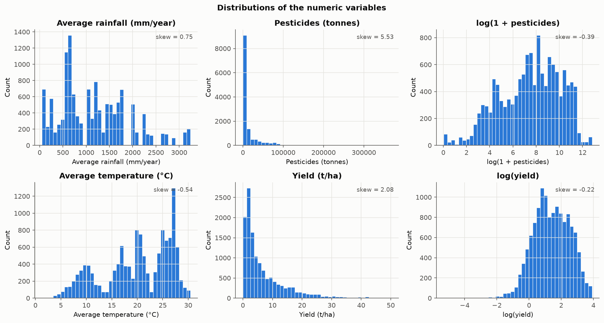
Yield is right-skewed (skew 2.08). log(yield) is almost symmetric (skew −0.22), which is why a
log-target model is tried later as a correction. Raw pesticide use is concentrated near zero with a
very long tail; log(1 + pesticides) is close to symmetric.

### 5.3 Box plots — `02_boxplot_yield_by_crop.png`, `03_boxplots_numeric.png`
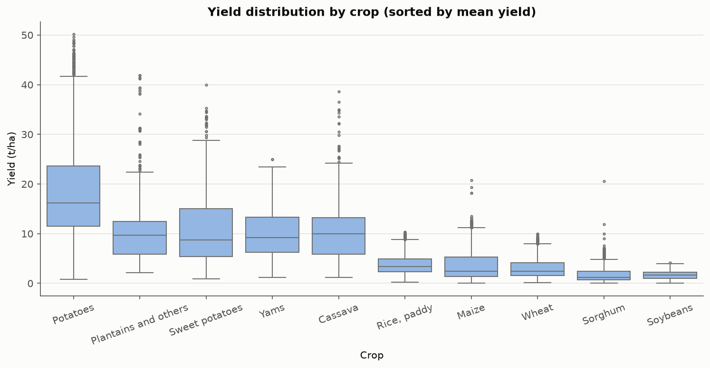
The tuber crops (potatoes, plantains, sweet potatoes, yams, cassava) have higher medians and much
wider spreads than the cereals and soybeans. Most of the pooled "outliers" belong to potatoes, which
confirms they are real.

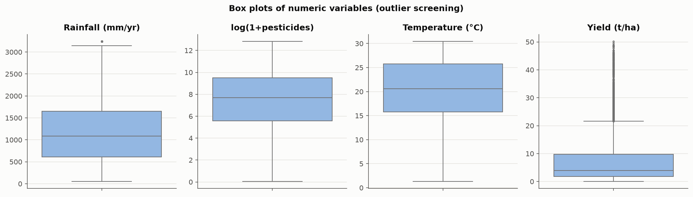

### 5.4 Correlation matrix and heatmap — `05_correlation_heatmap.png`
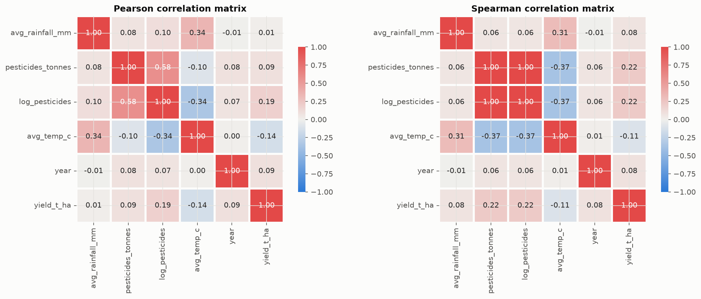

| Correlation with yield | Pearson r | Spearman ρ |
|---|---|---|
| Rainfall | 0.013 | 0.075 |
| Pesticides (raw) | 0.092 | 0.220 |
| log(1+pesticides) | **0.186** | **0.220** |
| Temperature | **−0.143** | −0.106 |
| Year | 0.088 | 0.084 |

**Interpretation:** each numeric variable on its own is only **weakly** correlated with yield
(|r| < 0.2). Most of the variation in yield comes from *which crop* is grown and *where*, not from any
single climate number. Among the predictors, rainfall and temperature are moderately correlated
(r = 0.34), and log-pesticides and temperature are negatively correlated (r = −0.34): cooler countries
tend to be richer and use more pesticides. None of these correlations is high enough to cause severe
multicollinearity (checked with VIF in section 8).

### 5.5 Scatter plots — `04_scatter_features_vs_yield.png`
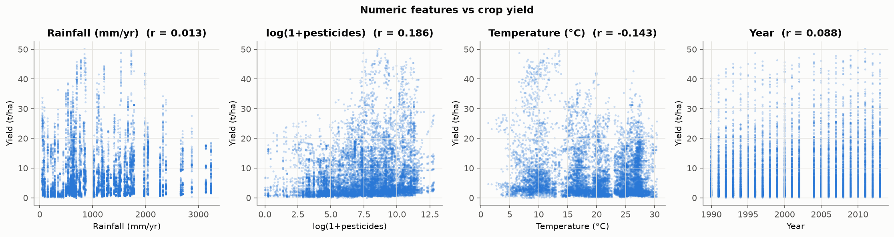
The clouds show no clear straight-line pattern. Yield forms horizontal bands, which are the different
crops. Rainfall forms vertical stripes because each country has a single, fixed rainfall value.

### 5.6 Trends over time — `06_yield_trend_by_crop.png`
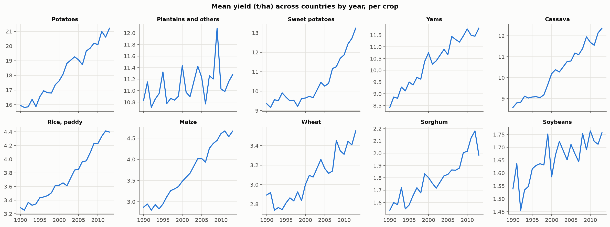
The mean yield across countries rises slowly for most crops between 1990 and 2013, which fits gradual
technological improvement. This is why `year` is kept as a predictor.

### 5.7 Summary of relationships found
1. **Crop type** is by far the strongest factor (η² = 0.54).
2. **Country** (which stands in for soil, irrigation, technology and management) is the second
   strongest factor (η² = 0.21).
3. Pesticide use (+), temperature (−) and year (+) have small but consistent associations with yield.
4. Rainfall, as recorded here, has almost no linear association with yield (r = 0.013).

---

## 6. Simple Linear Regression

### 6.1 Model
$$Y = \beta_0 + \beta_1 X + \varepsilon,\qquad \varepsilon \sim (0,\sigma^2)$$
Ordinary Least Squares (OLS) chooses β₀ and β₁ to minimise $\sum (y_i - \hat y_i)^2$:
$$\hat\beta_1 = \frac{\sum (x_i-\bar x)(y_i-\bar y)}{\sum (x_i-\bar x)^2},\qquad \hat\beta_0 = \bar y - \hat\beta_1 \bar x$$

### 6.2 Choice of X
The predictor was chosen as the numeric feature with the largest |Pearson r| with yield, computed **in
the training set only**. The training correlations were: rainfall 0.017, **log-pesticides 0.183**,
temperature −0.140 and year 0.088, so **X = log(1 + pesticides)**.

```python
slr = smf.ols("yield_t_ha ~ log_pesticides", data=train_df).fit()
```

### 6.3 Results (training n = 10,504)

| | Estimate | Std. error | t | p-value | 95 % CI |
|---|---|---|---|---|---|
| β₀ (intercept) | 2.9580 | 0.232 | 12.77 | < 0.001 | [2.504, 3.412] |
| β₁ (log-pesticides) | **0.5598** | 0.0293 | 19.09 | 6.4 × 10⁻⁸⁰ | [0.502, 0.617] |

**Fitted equation:** $\widehat{\text{Yield}} = 2.958 + 0.560 \times \ln(1+\text{pesticides})$

F-statistic = 364.6 (p = 6.4 × 10⁻⁸⁰). Training R² = 0.0335.

**Interpretation of β₁:** because X is in logs, **doubling** national pesticide use goes with an
average yield that is higher by 0.5598 × ln 2 ≈ **0.39 t/ha**. The slope is clearly non-zero
(p < 0.001). This is an *association*, not a cause. Pesticide use is a national total that also
reflects how large and how developed a country's farm sector is.

### 6.4 Regression line — `07_slr_regression_line.png`
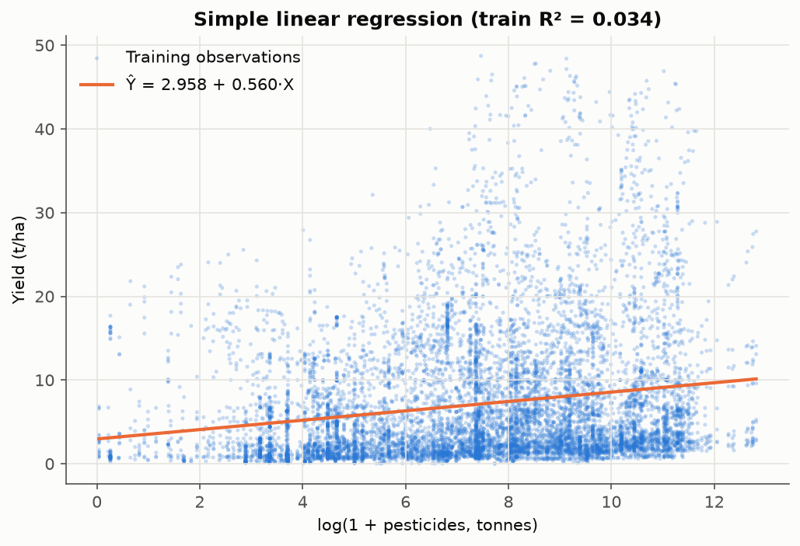

### 6.5 Test-set performance (n = 2,626)
| R² | MAE | MSE | RMSE |
|---|---|---|---|
| **0.0374** | 5.7294 | 61.9214 | 7.8690 |

**Interpretation:** a slope can be highly *significant* and still have almost no *predictive* power.
With 10,504 observations even a tiny effect gets a small p-value, but log-pesticides explains only
about 3–4 % of the variation in yield. A typical prediction is off by about 5.7 t/ha. One numeric
variable is not enough to predict yield.

---

## 7. Multiple Linear Regression

### 7.1 Model
$$Y = \beta_0 + \beta_1\,\text{Rain} + \beta_2\,\ln(1+\text{Pest}) + \beta_3\,\text{Temp} + \beta_4\,\text{Year} + \sum_{k=1}^{9}\gamma_k D_k + \varepsilon$$

Here D₁…D₉ are dummy (0/1) variables for the crops. Cassava is the reference category. In matrix form
$\mathbf{y} = \mathbf{X}\boldsymbol\beta + \boldsymbol\varepsilon$, and the OLS solution is
$\hat{\boldsymbol\beta} = (\mathbf{X}^\top\mathbf{X})^{-1}\mathbf{X}^\top\mathbf{y}$.

*Why country is left out here:* rainfall has a single value per country, so rainfall is an exact
linear combination of the country dummies. Including both would make $\mathbf X^\top\mathbf X$
singular. Country is brought in during Phase 2, where regularisation and trees can handle it.

```python
mlr = smf.ols("yield_t_ha ~ avg_rainfall_mm + log_pesticides + avg_temp_c + year + C(crop)",
              data=train_df).fit()
```

### 7.2 Coefficients (training data)

| Term | Coef. | Std. err. | t | p | 95 % CI |
|---|---|---|---|---|---|
| Intercept | −158.155 | 13.786 | −11.47 | < 0.001 | [−185.18, −131.13] |
| Rainfall (per mm) | −0.000198 | 0.000073 | −2.72 | 0.0066 | [−0.000341, −0.000055] |
| log(1+pesticides) | **0.5733** | 0.0207 | 27.66 | < 0.001 | [0.533, 0.614] |
| Temperature (per °C) | **−0.1537** | 0.0088 | −17.52 | < 0.001 | [−0.171, −0.137] |
| Year | **0.0842** | 0.0069 | 12.22 | < 0.001 | [0.071, 0.098] |
| Maize | −7.835 | 0.222 | −35.27 | < 0.001 | |
| Plantains and others | 1.094 | 0.313 | 3.50 | < 0.001 | |
| Potatoes | 6.258 | 0.222 | 28.14 | < 0.001 | |
| Rice, paddy | −7.643 | 0.231 | −33.04 | < 0.001 | |
| Sorghum | −9.481 | 0.236 | −40.25 | < 0.001 | |
| Soybeans | −10.536 | 0.244 | −43.14 | < 0.001 | |
| Sweet potatoes | −0.651 | 0.243 | −2.68 | 0.007 | |
| Wheat | −9.093 | 0.231 | −39.32 | < 0.001 | |
| Yams | 0.208 | 0.315 | 0.66 | 0.509 | |

Training R² = 0.607, adjusted R² = 0.606, F(13, 10490) = 1244 (p < 0.001), AIC = 63,420.

### 7.3 Interpretation of the coefficients (holding the other variables constant)
- **Temperature:** each +1 °C in a country's average temperature goes with a yield lower by
  **0.154 t/ha**. This fits heat stress on crops, but warmer countries also differ in income and
  technology, so this is not a causal climate effect.
- **Pesticides:** doubling pesticide use goes with **+0.40 t/ha** (0.5733 × ln 2).
- **Year:** yield rises by **0.084 t/ha per year** (about 0.84 t/ha per decade), the
  technology/productivity trend.
- **Rainfall:** −0.198 t/ha per 1,000 mm. The effect is small and, as section 8 shows, it is **not
  significant** once the errors are allowed to be correlated within a country.
- **Crop dummies** are differences from cassava. For example, potatoes yield **6.26 t/ha more** than
  cassava under the same conditions, and soybeans **10.54 t/ha less**. Yams are not significantly
  different from cassava (p = 0.51).

**Relative importance:** the effect of a one-standard-deviation increase in each feature is
+1.48 t/ha for log-pesticides, −1.03 for temperature, +0.59 for year and −0.15 for rainfall.

### 7.4 Test-set performance
| R² | MAE | MSE | RMSE |
|---|---|---|---|
| **0.6151** | 3.1805 | 24.7623 | 4.9762 |

Adding crop type and the other variables raises test R² from 0.037 to 0.615 and lowers RMSE from 7.87
to 4.98 t/ha. Train R² (0.607) and test R² (0.615) are almost the same, so the model is not
overfitting.

---

## 8. Regression Assumption Testing

All tests are run on the residuals of the MLR from section 7, using the training data. The
significance level is α = 0.05.

### 8.1 Linearity
- **Purpose:** check that E[Y | X] is a linear function of the predictors.
- **Graphical check:** residuals vs fitted values (`08_mlr_diagnostics_raw.png`, top-left) and
  residuals vs each predictor (`09_residuals_vs_predictors.png`).
- **Formal test:** Utts' Rainbow test. **H₀: the relationship is linear.**
- **Result:** F = 1.022, **p = 0.210**, so H₀ is not rejected.
- **Interpretation:** the Rainbow test finds no evidence of non-linearity on average. However, the
  residual-vs-fitted plot shows a fan and diagonal stripes. These come from the additive model
  forcing the *same* temperature, pesticide and year effects on every crop, whose yields differ by a
  factor of ten. **Verdict: partly satisfied.** There is no overall curvature, but the plots point to
  crop × feature interactions, which the tree models in Phase 2 capture.

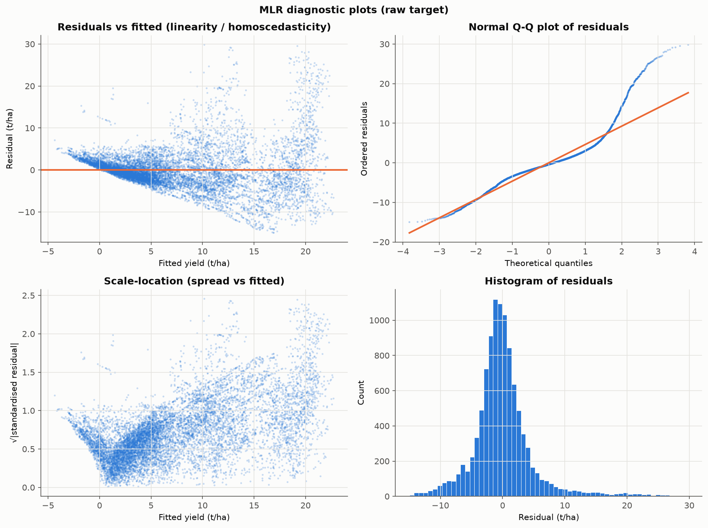

### 8.2 Normality of residuals
- **Purpose:** t-tests and confidence intervals assume normally distributed errors.
- **H₀: the residuals are normally distributed.**
- **Shapiro–Wilk** (on a random sample of 5,000 residuals, the maximum SciPy supports):
  W = 0.882, **p = 5.0 × 10⁻⁵²**.
- **Jarque–Bera** (all residuals): JB = 21,062, **p ≈ 0**. Residual skewness = 1.51, kurtosis = 9.24
  (a normal distribution has 0 and 3).
- **Q-Q plot:** the points curve upward well above the line in the right tail.
- **Verdict: NOT satisfied.** The residuals are right-skewed and heavy-tailed, mirroring the skewed
  yield. With n > 10,000 the coefficient estimates themselves stay valid (central limit theorem);
  what suffers is the exactness of the intervals and the efficiency of OLS.

### 8.3 Homoscedasticity (constant error variance)
- **Purpose:** OLS standard errors assume the error variance is the same everywhere.
- **H₀: the residual variance is constant (homoscedastic).**
- **Breusch–Pagan:** LM = 1,797.2, **p ≈ 0** (F = 166.6, p ≈ 0).
- **Plot:** the scale-location plot rises with the fitted value. High-yield crops have much larger
  errors.
- **Verdict: NOT satisfied** (heteroscedasticity).

### 8.4 Independence of errors
- **Purpose:** the errors should not be correlated with each other.
- **H₀: there is no first-order autocorrelation.** The Durbin–Watson statistic is about 2 when there
  is none, below 2 for positive autocorrelation, and above 2 for negative.
- Durbin–Watson depends on the **order** of the rows. In random training order, DW = 2.009, which is
  meaningless because shuffling hides any structure. The data are a **panel** (country × crop over
  years), so the meaningful order is country → crop → year. In that order, **DW = 0.195**.
- **Verdict: NOT satisfied.** There is strong positive autocorrelation: a country that over-yields
  one year tends to over-yield the next. As a result, classical standard errors are too small.

### 8.5 Multicollinearity — Variance Inflation Factor
$$\text{VIF}_j = \frac{1}{1-R_j^2}$$
where $R_j^2$ is the R² from regressing predictor j on all the other predictors. Rule of thumb:
VIF > 5 means moderate and VIF > 10 means serious multicollinearity.

| Predictor | VIF |
|---|---|
| Rainfall | 1.259 |
| log(1+pesticides) | 1.227 |
| Temperature | 1.472 |
| Year | 1.009 |
| Crop dummies | 1.431 – 2.884 |

**Verdict: satisfied.** Every VIF is below 3. (statsmodels warns about a large condition number,
6.7 × 10⁵. That is a scaling artefact of using raw `year` values near 2000 alongside an intercept,
not real collinearity, as the VIFs show.)

### 8.6 Corrective measures that were applied

**(a) Log-transform the target.** Fit the same model to ln(yield), then convert predictions back to
t/ha using Duan's smearing factor (1.198).

| Test (log model) | Result | Change from raw model |
|---|---|---|
| Rainbow (linearity) | F = 1.053, p = 0.032 | borderline rejection |
| Shapiro–Wilk | W = 0.957, p = 3.7 × 10⁻³⁶ | still non-normal, but W is closer to 1 |
| Residual skew / kurtosis | −0.78 / 6.77 | much less skewed (was 1.51 / 9.24) |
| Breusch–Pagan | LM = 300.3, p = 2.1 × 10⁻⁵⁶ | still heteroscedastic, LM 6× smaller |
| Durbin–Watson (panel order) | 0.252 | autocorrelation remains |
| R² (log scale, train) | 0.6885 | |
| **Test set on t/ha scale** | **R² = 0.6472, MAE = 2.938, RMSE = 4.764** | better than the raw MLR (0.615 / 3.181 / 4.976) |

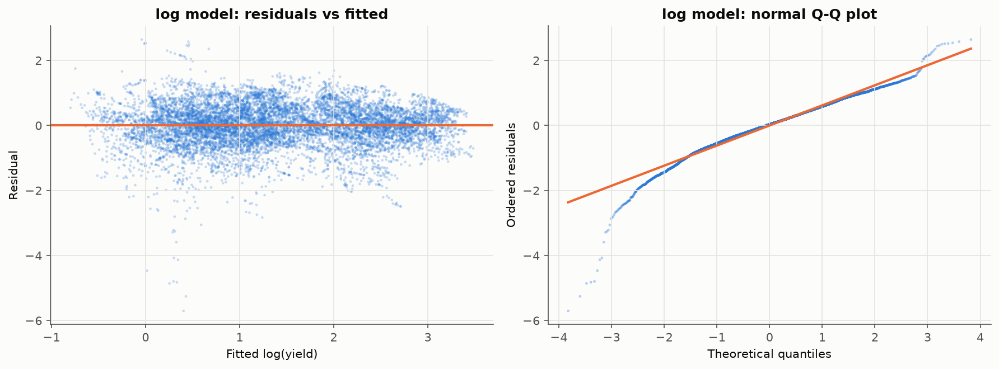

The log transform **reduces** the violations a great deal and improves accuracy, but it does not
remove them.

**(b) Robust standard errors** (these change the inference, not the coefficients):

| Coefficient | Classical SE | HC3 (heteroscedasticity-robust) SE | Cluster-by-country SE | p (cluster) |
|---|---|---|---|---|
| Rainfall | 0.000073 | 0.000073 | 0.00040 | **0.620** |
| log(1+pesticides) | 0.0207 | 0.0188 | 0.0861 | < 0.001 |
| Temperature | 0.0088 | 0.0091 | 0.0474 | 0.0012 |
| Year | 0.0069 | 0.0068 | 0.0126 | < 0.001 |

Standard errors clustered by country allow for both heteroscedasticity and correlation within a
country. They are **4–5 times larger** than the classical ones. **Rainfall loses significance**
(p = 0.62). Pesticides, temperature and year stay significant. This is the most trustworthy inference
in this report.

**Other remedies, not applied because Phase 2 covers them:** crop × feature interaction terms;
weighted least squares; mixed-effects (random-intercept) models for the panel; non-linear models.

---

## 9. Estimator Validation

### 9.1 Why validation is needed
A coefficient or an R² computed once, on one sample, could be a lucky draw. Validation answers two
questions:
1. **How well will the model predict new data?**
2. **How stable are the estimated coefficients** if the sample changes?

### 9.2 K-fold cross-validation (K = 5)
The training set is split into 5 equal folds. The model is trained on 4 folds and tested on the 5th,
and this is repeated 5 times so every fold is the test fold once. The average and the spread of the 5
scores estimate out-of-sample performance and its variability. The same `KFold(5, shuffle=True,
random_state=42)` object is used for **every** model in this project.

| Fold | SLR R² | SLR RMSE | MLR R² | MLR RMSE |
|---|---|---|---|---|
| 1 | 0.0332 | 7.625 | 0.6117 | 4.832 |
| 2 | 0.0215 | 7.521 | 0.6098 | 4.750 |
| 3 | 0.0337 | 7.881 | 0.6000 | 5.070 |
| 4 | 0.0407 | 7.751 | 0.6188 | 4.887 |
| 5 | 0.0341 | 7.976 | 0.5869 | 5.216 |
| **Mean ± SD** | **0.0327 ± 0.0070** | **7.751 ± 0.184** | **0.6054 ± 0.0123** | **4.951 ± 0.189** |

**MLR numeric coefficients in each fold**

| Fold | Rainfall | log-pesticides | Temperature | Year |
|---|---|---|---|---|
| 1 | −0.00014 | 0.5753 | −0.1583 | 0.0955 |
| 2 | −0.00023 | 0.5789 | −0.1476 | 0.0847 |
| 3 | −0.00022 | 0.5793 | −0.1527 | 0.0801 |
| 4 | −0.00024 | 0.5797 | −0.1542 | 0.0836 |
| 5 | −0.00017 | 0.5536 | −0.1559 | 0.0773 |

The signs never change, and each coefficient moves only a little between folds (pesticides
0.554–0.580, temperature −0.148 to −0.158). The fold R² values cover a narrow range (0.587–0.619).
**The estimator is stable**, and the CV R² (0.605) agrees with the test R² (0.615).

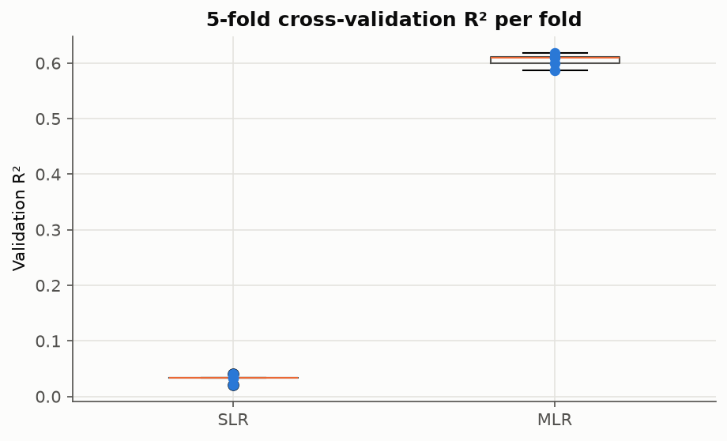

### 9.3 Bootstrap sampling
**How it works:**
1. Draw n rows *with replacement* from the n training rows.
2. Refit the model.
3. Record the coefficients.
4. Evaluate the model on the **out-of-bag (OOB)** rows (rows not drawn this time, about 36.8 %).

This is repeated B = 1,000 times. The standard deviation of the 1,000 coefficient values is the
**bootstrap standard error**. The 2.5th and 97.5th percentiles give a **95 % percentile confidence
interval**. Neither requires the normality assumption that failed in section 8.

Because section 8.4 found strong within-country correlation, a second, **cluster (block) bootstrap**
was also run. It resamples whole *countries* (B = 500), which keeps each country's correlated rows
together.

| Coefficient | OLS est. | Bootstrap mean | Row-bootstrap SE | OLS SE | Row 95 % CI | Cluster SE | Cluster 95 % CI |
|---|---|---|---|---|---|---|---|
| Rainfall | −0.000198 | −0.000199 | 0.00007 | 0.00007 | [−0.00034, −0.00005] | 0.00042 | **[−0.00098, 0.00068]** |
| log(1+pesticides) | 0.5733 | 0.5732 | 0.0186 | 0.0207 | [0.538, 0.612] | 0.0878 | [0.412, 0.745] |
| Temperature | −0.1537 | −0.1535 | 0.0091 | 0.0088 | [−0.171, −0.136] | 0.0472 | [−0.246, −0.059] |
| Year | 0.0842 | 0.0847 | 0.0066 | 0.0069 | [0.073, 0.097] | 0.0119 | [0.062, 0.109] |
| SLR slope | 0.5598 | 0.5588 | 0.0270 | 0.0293 | [0.507, 0.610] | — | — |

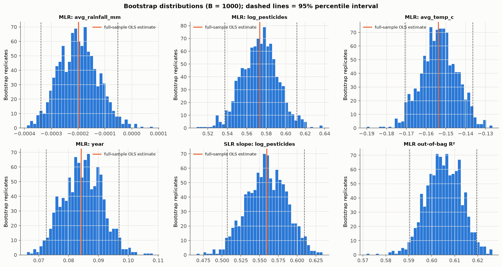

**Interpretation**
- The bootstrap means are almost the same as the OLS estimates, so OLS shows **no visible bias**.
- The bootstrap distributions are bell-shaped and narrow (see the figure).
- The row bootstrap reproduces the classical SEs. The **cluster bootstrap SEs are 4–5 times larger**,
  matching the cluster-robust SEs in section 8.6(b). Once within-country dependence is respected, the
  rainfall interval **includes 0**. The pesticide (+), temperature (−) and year (+) intervals still
  exclude 0.

**Variation in model performance (out-of-bag, B = 1,000)**

| | Mean | SD | 95 % interval |
|---|---|---|---|
| MLR R² | 0.6052 | 0.0077 | [0.590, 0.620] |
| MLR RMSE | 4.953 | 0.089 | [4.763, 5.135] |
| SLR R² | 0.0331 | 0.0040 | [0.025, 0.040] |
| SLR RMSE | 7.752 | 0.124 | [7.513, 8.007] |

The intervals for SLR and MLR do not overlap, so MLR is better beyond sampling noise.

---

## 10. Phase 1 Results

| Item | Simple Linear Regression | Multiple Linear Regression |
|---|---|---|
| Predictors | log(1+pesticides) | rainfall, log-pesticides, temperature, year, 9 crop dummies |
| Training R² (adj.) | 0.0335 | 0.607 (0.606) |
| 5-fold CV R² (mean ± SD) | 0.0327 ± 0.0070 | 0.6054 ± 0.0123 |
| Test R² | 0.0374 | 0.6151 |
| Test MAE / RMSE (t/ha) | 5.729 / 7.869 | 3.181 / 4.976 |
| Bootstrap OOB R² (95 % CI) | 0.033 [0.025, 0.040] | 0.605 [0.590, 0.620] |

**Key coefficients:** SLR slope = 0.560 per log-unit of pesticides. In the MLR: temperature −0.154
t/ha per °C, year +0.084 t/ha per year, log-pesticides +0.573, rainfall −0.0002 per mm
(not significant with clustered SEs). Crop is the dominant factor; potatoes are +6.26 t/ha and
soybeans −10.54 t/ha relative to cassava.

**Assumption checks**

| Assumption | Test | Result | Satisfied? |
|---|---|---|---|
| Linearity | Rainbow; residual plots | p = 0.210; fan/stripes visible | Partly |
| Normality | Shapiro–Wilk; Jarque–Bera; Q-Q | p ≈ 0; skew 1.51 | No |
| Homoscedasticity | Breusch–Pagan | p ≈ 0 | No |
| Independence | Durbin–Watson (panel order) | 0.195 | No |
| No multicollinearity | VIF | all < 3 | Yes |

**Statistical interpretation.** The MLR coefficients are stable (cross-validation, bootstrap) and
unbiased-looking. But three classical assumptions fail, so the *classical* p-values are too
optimistic. Using robust and cluster methods, the evidence for associations of yield with
temperature (negative), pesticide use (positive) and time trend (positive) holds up; the evidence for
rainfall does not. A linear model with crop effects explains about 61 % of yield variance. Most of the
remaining variance comes from country-level differences and crop-specific responses, which Phase 2
addresses.

---

# PHASE 2: ADVANCED PREDICTIVE MODELLING AND COMPARATIVE EVALUATION

## 11. Feature Selection

All feature-selection steps use **training data only**.

### 11.1 Correlation and association based
| Feature | Type | Pearson r | Spearman ρ | η² |
|---|---|---|---|---|
| Rainfall | numeric | 0.017 | 0.075 | |
| log(1+pesticides) | numeric | 0.183 | 0.215 | |
| Temperature | numeric | −0.140 | −0.103 | |
| Year | numeric | 0.088 | 0.087 | |
| Crop | categorical | | | **0.534** |
| Country | categorical | | | **0.206** |

### 11.2 Recursive Feature Elimination with cross-validation (RFECV)
RFE repeatedly fits a linear model on the full one-hot design (115 columns), removes the weakest
column, and keeps the subset with the best 5-fold CV RMSE. It kept **110 of 115** columns and removed
only **log-pesticides** and 4 country dummies (Brazil, Hungary, Morocco, Niger).
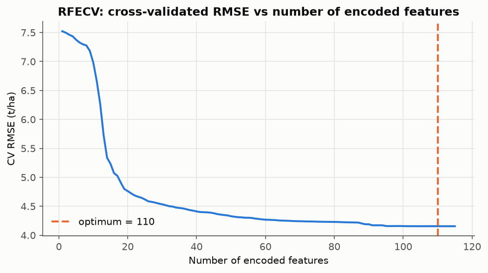
*Why pesticides was dropped:* once every country has its own dummy, national pesticide use adds little
new information, because it mostly reflects the country. This matches the near-zero pesticide
coefficient in Ridge and LASSO below.

### 11.3 Model-based importance
A Random Forest was trained on 80 % of the training set. Permutation importance (the drop in R² when
one feature is randomly shuffled, 10 repeats) was measured on the remaining 20 %.

| Feature | RF impurity share | Permutation importance (ΔR², mean ± SD) |
|---|---|---|
| Crop | 0.537 | 1.485 ± 0.039 |
| Temperature | 0.086 | 0.282 ± 0.018 |
| Rainfall | 0.094 | 0.270 ± 0.010 |
| log(1+pesticides) | 0.119 | 0.204 ± 0.012 |
| Country | 0.133 | 0.170 ± 0.011 |
| Year | 0.031 | 0.051 ± 0.007 |

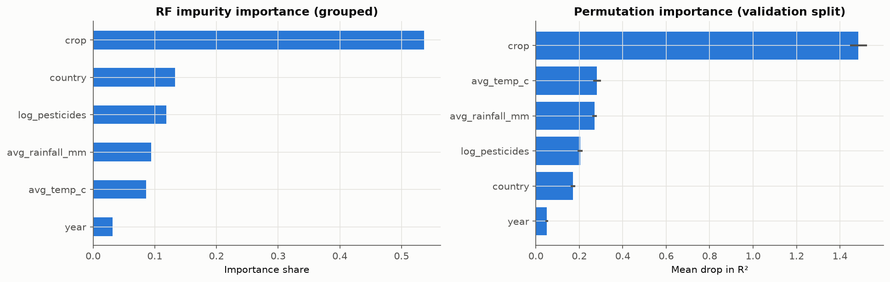

### 11.4 Selected features and why they matter
**Rule, fixed before looking at the results:** keep a feature if shuffling it lowers validation R² by
more than 0.001. **All six features passed**, so all are used in Phase 2.
- **Crop:** crops differ enormously in biomass and in what is harvested (tubers vs grain).
- **Country:** stands in for soils, irrigation, mechanisation, seed varieties and the other things
  this dataset does not record.
- **Temperature:** heat and cold stress, length of growing season.
- **Pesticides:** crop protection, and indirectly how intensive farming is.
- **Year:** technology trend.
- **Rainfall:** its large importance in the Random Forest has to be read with care. Rainfall has a
  single fixed value per country, so the forest uses it as **another country identifier**, not as a
  weather signal. This is not evidence that rainfall affects yield.

Because every feature was kept, a check comparing "selected vs all features" gives identical CV RMSE
(LASSO 4.156, RF 1.471). This is expected, since the two sets are the same.

---

## 12. Ridge and LASSO Regression

Both models use the six selected features: numeric features standardised, crop and country one-hot
encoded (115 columns). α was tuned with 5-fold CV RMSE on the training set.

### 12.1 Ridge regression (L2)
$$\hat\beta^{\text{ridge}} = \arg\min_\beta \sum_i (y_i - x_i^\top\beta)^2 + \alpha\sum_j \beta_j^2$$
The L2 penalty **shrinks** all coefficients towards zero, without making any of them exactly zero. It
stabilises estimates when predictors are correlated (here, rainfall and the country dummies).
Closed form: $\hat\beta = (X^\top X + \alpha I)^{-1}X^\top y$.

**Tuning:** 25 values of α from 10⁻³ to 10³. **Best α = 0.178**, CV RMSE = 4.1557.

### 12.2 LASSO regression (L1)
$$\hat\beta^{\text{lasso}} = \arg\min_\beta \frac{1}{2n}\sum_i (y_i - x_i^\top\beta)^2 + \alpha\sum_j |\beta_j|$$
The L1 penalty can set coefficients **exactly to zero**, so LASSO also selects features.

**Tuning:** 25 values of α from 10⁻⁴ to 10^0.5. **Best α = 0.000154**, CV RMSE = 4.1556.
Coefficients set to zero at this α: **3 of 115** (country dummies for Albania, Colombia and Senegal).

Because the CV-optimal α is tiny, the **one-standard-error rule** was also applied: take the
*largest* α whose CV RMSE is within one standard error of the best. This gives **α = 0.00487**, with
CV RMSE = 4.189 (only 0.8 % worse), and **26 of 115 coefficients set to zero**. All 26 are country
dummies, which the model shrinks into the baseline. No crop and no numeric feature was removed.

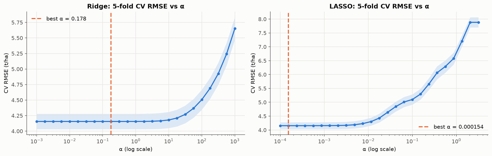
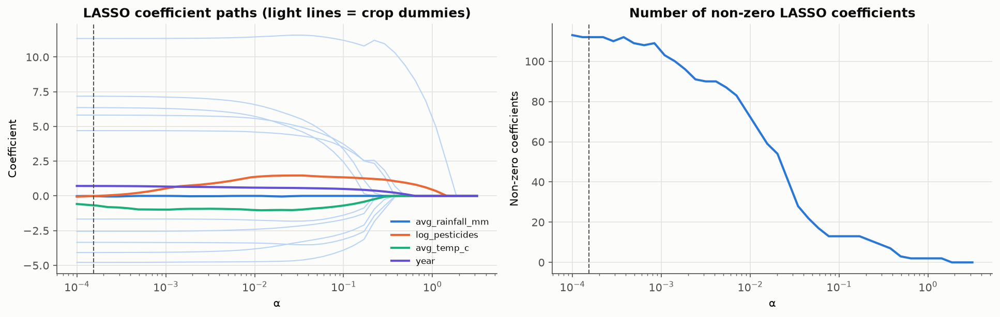

**Coefficients of the numeric features** (t/ha per 1 SD increase):

| Feature | Ridge | LASSO | LASSO (1-SE) |
|---|---|---|---|
| Rainfall | 0.024 | −0.017 | −0.009 |
| log(1+pesticides) | −0.083 | −0.008 | 1.037 |
| Temperature | −0.804 | −0.668 | −0.942 |
| Year | 0.724 | 0.714 | 0.623 |

Once country is in the model, **temperature (−) and year (+) are the stable numeric effects**. The
rainfall and pesticide coefficients are close to zero and change sign between models, because their
information overlaps with country. In the 1-SE model, 26 country dummies are removed, and pesticides
takes back part of the between-country signal.

**Test-set results**

| Model | R² | MAE | MSE | RMSE |
|---|---|---|---|---|
| Ridge (α = 0.178) | 0.7349 | 2.8616 | 17.0531 | 4.1295 |
| LASSO (α = 0.000154) | 0.7350 | 2.8580 | 17.0446 | 4.1285 |
| LASSO (1-SE, α = 0.00487) | 0.7301 | 2.7919 | 17.3649 | 4.1671 |
| *Unregularised OLS, same features* | 0.7351 | 2.8622 | 17.0404 | 4.1280 |

### 12.3 Ridge vs LASSO
| | Ridge (L2) | LASSO (L1) |
|---|---|---|
| Penalty | α Σβ² | α Σ\|β\| |
| Effect | shrinks all coefficients smoothly | shrinks, and sets some exactly to 0 |
| Feature selection | no | yes (26 country dummies at the 1-SE α) |
| Correlated predictors | shares weight among them | tends to keep one, drop the others |
| Solution | closed form | iterative (coordinate descent) |

**What the experiment shows:** with 10,504 rows and 115 columns there is little variance to remove,
so the best α is small and Ridge, LASSO and plain OLS perform almost identically (test R² ≈ 0.735).
Regularisation brings **no accuracy gain** here. Its value is a **simpler model**: LASSO (1-SE) drops
23 % of the coefficients at a cost of 0.005 in R². It is also more robust for unseen countries
(section 15.3).

---

## 13. Machine Learning Model Development

All tree models use the six features, with crop and country one-hot encoded (no scaling needed). They
are tuned with `GridSearchCV` on the same 5 folds, scoring by RMSE.

### 13.1 Decision Tree Regressor
- **Algorithm:** splits the data again and again on the feature/threshold that most reduces the sum
  of squared errors, $\text{SSE} = \sum (y_i-\bar y_{\text{node}})^2$. Each leaf predicts the mean
  yield of its training rows.
- **Why it suits crop yield:** it captures interactions automatically (for example, "if crop =
  potatoes **and** country = UK, then …") and non-linear thresholds such as heat limits. It needs no
  normality or constant-variance assumptions.
- **Tuning grid:** max_depth ∈ {4, 6, 8, 10, 12, 15, 20, 25, None} × min_samples_leaf ∈ {1, 2, 5, 10, 20}.
- **Best:** max_depth = 25, min_samples_leaf = 1 (CV RMSE = 1.857).

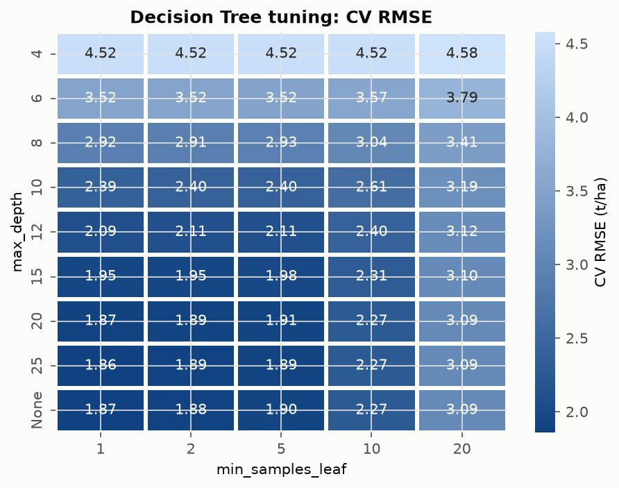

### 13.2 Random Forest Regressor
- **Algorithm:** an ensemble of B decision trees. Each tree is trained on a bootstrap sample, and each
  split considers a random subset of features. The prediction is the average across trees,
  $\hat y = \frac1B\sum_b T_b(x)$. Averaging many de-correlated deep trees lowers variance and keeps
  bias low.
- **Why it suits crop yield:** it keeps the tree's ability to model interactions but is far less
  prone to overfitting. It handles mixed feature types and gives feature importances.
- **Tuning grid:** max_features ∈ {sqrt, 0.33, 0.6, 1.0} × min_samples_leaf ∈ {1, 2, 4} ×
  max_depth ∈ {None, 20}, with 300 trees.
- **Best:** max_features = 0.6, min_samples_leaf = 1, max_depth = None (CV RMSE = 1.471).

### 13.3 Gradient Boosting (optional, HistGradientBoostingRegressor)
- **Algorithm:** builds shallow trees one after another. Each new tree fits the residuals (the
  negative gradient of the squared-error loss) of the trees before it:
  $F_m(x) = F_{m-1}(x) + \eta\,h_m(x)$.
- **Tuning grid:** learning_rate ∈ {0.05, 0.1} × max_iter ∈ {300, 800} × max_leaf_nodes ∈ {31, 63} ×
  min_samples_leaf ∈ {10, 20}.
- **Best:** learning_rate = 0.1, max_iter = 800, max_leaf_nodes = 63, min_samples_leaf = 10
  (CV RMSE = 1.568).

```python
rf_gs = GridSearchCV(
    Pipeline([("prep", ColumnTransformer([("num", "passthrough", NUM),
                                          ("cat", OneHotEncoder(handle_unknown="ignore"), CAT)])),
              ("model", RandomForestRegressor(n_estimators=300, random_state=42))]),
    {"model__max_features": ["sqrt", 0.33, 0.6, 1.0], "model__min_samples_leaf": [1, 2, 4],
     "model__max_depth": [None, 20]},
    cv=KFold(5, shuffle=True, random_state=42), scoring="neg_root_mean_squared_error"
).fit(X_train, y_train)
```

---

## 14. Model Evaluation

### 14.1 Metrics
For n test observations with actual yield $y_i$, prediction $\hat y_i$ and mean $\bar y$:

| Metric | Formula | Meaning |
|---|---|---|
| R² | $1-\dfrac{\sum (y_i-\hat y_i)^2}{\sum (y_i-\bar y)^2}$ | Share of yield variance explained. 1 is perfect; 0 is no better than always predicting the mean. Can be negative. |
| MAE | $\frac1n\sum \lvert y_i-\hat y_i\rvert$ | Average absolute error, in t/ha. Easy to read; less sensitive to large errors. |
| MSE | $\frac1n\sum (y_i-\hat y_i)^2$ | Average squared error, in (t/ha)². Penalises large errors heavily. |
| RMSE | $\sqrt{\text{MSE}}$ | Typical error size, in t/ha. Same units as yield. |

### 14.2 Results — 20 % hold-out test set (n = 2,626)

| Model | R² | MAE | MSE | RMSE |
|---|---|---|---|---|
| Simple Linear Regression | 0.0374 | 5.7294 | 61.9214 | 7.8690 |
| Multiple Linear Regression | 0.6151 | 3.1805 | 24.7623 | 4.9762 |
| Ridge Regression | 0.7349 | 2.8616 | 17.0531 | 4.1295 |
| LASSO Regression | 0.7350 | 2.8580 | 17.0446 | 4.1285 |
| Decision Tree Regressor | 0.9598 | 0.7868 | 2.5857 | 1.6080 |
| **Random Forest Regressor** | **0.9730** | **0.6559** | **1.7339** | **1.3168** |
| *Supplementary:* MLR (Phase 2 features, OLS) | 0.7351 | 2.8622 | 17.0404 | 4.1280 |
| *Supplementary:* LASSO (1-SE rule) | 0.7301 | 2.7919 | 17.3649 | 4.1671 |
| *Supplementary:* Gradient Boosting (HistGB) | 0.9637 | 0.8430 | 2.3325 | 1.5272 |

### 14.3 Cross-validation and overfitting check (training set)

| Model | Train R² | CV R² (mean ± SD) | CV RMSE (mean ± SD) | Test R² | Train − Test R² |
|---|---|---|---|---|---|
| SLR | 0.0335 | 0.0327 ± 0.0062 | 7.751 ± 0.165 | 0.0374 | −0.004 |
| MLR | 0.6066 | 0.6054 ± 0.0110 | 4.951 ± 0.169 | 0.6151 | −0.009 |
| Ridge | 0.7292 | 0.7219 ± 0.0088 | 4.156 ± 0.123 | 0.7349 | −0.006 |
| LASSO | 0.7292 | 0.7219 ± 0.0088 | 4.156 ± 0.123 | 0.7350 | −0.006 |
| Decision Tree | **0.9998** | 0.9443 ± 0.0050 | 1.857 ± 0.088 | 0.9598 | **+0.040** |
| Random Forest | 0.9958 | **0.9651 ± 0.0035** | **1.471 ± 0.068** | **0.9730** | +0.023 |
| Gradient Boosting | 0.9844 | 0.9603 ± 0.0030 | 1.568 ± 0.052 | 0.9637 | +0.021 |

(The CV SD here is computed over the 5 folds with ddof = 0, so it is slightly smaller than the
ddof = 1 values in section 9.)

**Interpretation**
- The linear models have **almost no train–test gap**: they underfit rather than overfit.
- The single Decision Tree fits the training data almost perfectly (R² = 0.9998). Its largest gap
  shows it is memorising some noise.
- The Random Forest has the **best CV and test scores** and a smaller gap than the single tree.

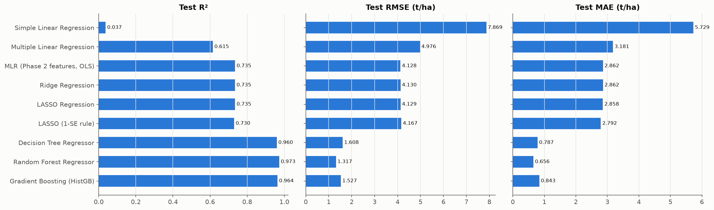
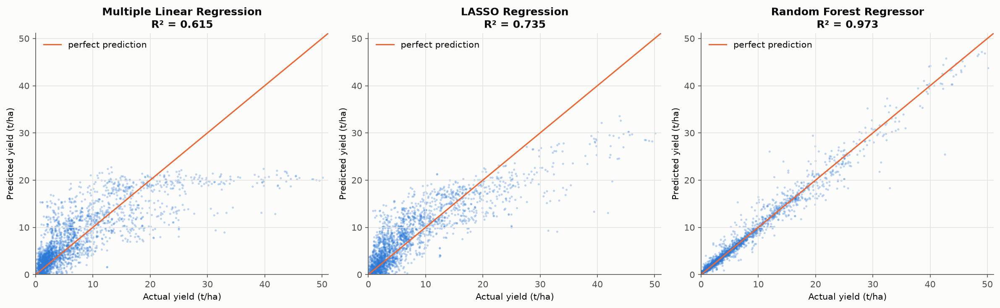

---

## 15. Comparative Analysis

### 15.1 Which model is best?
- **Best R² and lowest error:** the Random Forest, with test R² = 0.973, RMSE = 1.317 t/ha and
  MAE = 0.656 t/ha. A typical prediction is off by about 0.66 t/ha, against 3.18 t/ha for the MLR and
  5.73 t/ha for the SLR.
- **Ranking by test RMSE:** RF (1.317) < Gradient Boosting (1.527) < Decision Tree (1.608) ≪
  Ridge ≈ LASSO ≈ OLS-P2 (≈ 4.13) < MLR (4.976) < SLR (7.869).

### 15.2 Generalisation: three stricter tests
A random 80/20 split puts different years of the *same* country–crop series into both training and
test sets. Section 8.4 showed these are strongly correlated (DW = 0.195), so random-split scores are
**optimistic**. Two harder tests were added, using the tuned settings:
1. **Future years:** train on 1990–2009 (n = 10,775), test on 2010–2013 (n = 2,355).
2. **Unseen countries:** 5-fold GroupKFold by country, so no country appears in both training and
   validation.

| Model | Random split R² | Future years R² (RMSE) | Unseen countries R² ± SD (RMSE) |
|---|---|---|---|
| SLR | 0.037 | 0.006 (8.71) | 0.027 ± 0.030 (7.74) |
| MLR | 0.615 | 0.606 (5.48) | 0.589 ± 0.056 (5.01) |
| MLR (P2 features) | 0.735 | 0.705 (4.75) | 0.498 ± 0.064 (5.52) |
| Ridge | 0.735 | 0.704 (4.75) | 0.525 ± 0.061 (5.38) |
| LASSO | 0.735 | 0.705 (4.75) | 0.531 ± 0.038 (5.36) |
| LASSO (1-SE) | 0.730 | 0.701 (4.78) | 0.585 ± 0.047 (5.05) |
| Decision Tree | 0.960 | 0.904 (2.71) | 0.517 ± 0.100 (5.41) |
| **Random Forest** | **0.973** | **0.935 (2.23)** | 0.627 ± 0.076 (4.75) |
| Gradient Boosting | 0.964 | 0.930 (2.32) | **0.630 ± 0.079 (4.73)** |

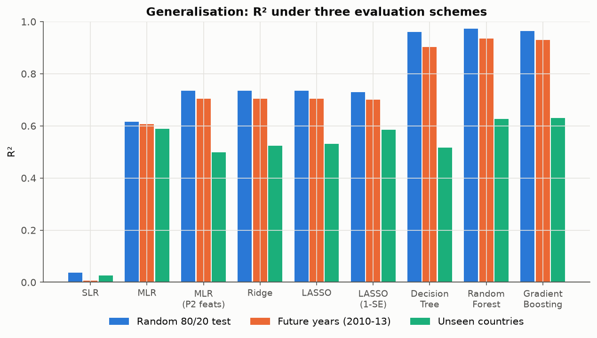

**What this shows**
- **Forecasting future years for countries already in the data** works well. The Random Forest still
  explains 93.5 % of the variance in 2010–2013 (RMSE 2.23 t/ha), and the ranking of models does not
  change.
- **Predicting a country never seen in training is much harder.** The best models drop to
  R² ≈ 0.63 (RF 0.627, GB 0.630; the difference is well within one SD). The single Decision Tree
  falls to 0.517. Models that rely on country dummies (MLR-P2, Ridge, LASSO) *lose* accuracy compared
  with the simple crop-only MLR (0.589), because a dummy for an unseen country carries no
  information. LASSO (1-SE), which removed 26 country dummies, holds up better (0.585) than
  unregularised OLS-P2 (0.498). This is a practical benefit of regularisation.
- **Generalisation, overall:** the Random Forest is best or tied-best in every scheme. The Decision
  Tree generalises worst among the tree models.

### 15.3 Why statistical and machine-learning models give different results
1. **Functional form.** Linear regression forces one additive slope for each feature: the same
   temperature effect for potatoes and soybeans, and a fixed shift per crop. In reality yields differ
   about tenfold between crops, and responses are crop- and country-specific. Trees learn these
   **interactions and thresholds** automatically.
2. **Purpose.** The statistical models are built for **inference**: interpretable coefficients,
   confidence intervals and hypothesis tests (Phase 1). ML models are built to minimise **prediction
   error** and give up interpretability to get it.
3. **Assumptions.** OLS's assumptions (normality, homoscedasticity, independence) were violated. That
   weakens its inference, but it is not why OLS predicts worse; the missing interactions are. Trees
   make no distributional assumptions.
4. **Memorising the panel.** Part of the ML advantage on the random split comes from recognising
   country × crop combinations seen in other years. The unseen-country test removes this, and the
   gap between models narrows sharply (RF 0.627 vs MLR 0.589).

**Statistical inference and predictive performance are separate questions.** The MLR answers "is
temperature associated with yield, and by how much?" (−0.154 t/ha per °C, significant with
clustered SEs). The Random Forest answers "what yield should we expect for this crop, country and
year?" with much smaller error.

---

## 16. Final Model Selection

| Criterion | Evidence | Winner |
|---|---|---|
| Prediction accuracy | Test R² 0.973, highest of all models | Random Forest |
| Error metrics | Lowest MAE (0.656), MSE (1.734) and RMSE (1.317) | Random Forest |
| Cross-validated stability | Highest CV R² (0.9651 ± 0.0035) | Random Forest |
| Generalisation to future years | R² 0.935 (2010–2013) | Random Forest |
| Generalisation to unseen countries | 0.627 vs 0.630 (GB), within noise | RF ≈ GB |
| Overfitting | Train–test gap 0.023, vs 0.040 for the Decision Tree | RF / GB |
| Complexity | 300 deep trees; the slowest of the main models to train and the largest to store | Linear models are simpler |
| Interpretability | Feature importance only; no coefficients | MLR / LASSO |

**Selected final model: Random Forest Regressor** (300 trees, max_features = 0.6,
min_samples_leaf = 1, no depth limit).

**Justification:** it has the lowest error on every accuracy metric and in every evaluation scheme
except unseen countries, where it ties with Gradient Boosting. Its cross-validated R² (0.9651) is also the highest. Its lack of interpretability is offset by keeping the **MLR** (with cluster-robust SEs)
as the companion *explanatory* model. The MLR is used to state *how* temperature, pesticide use and
time are associated with yield. The Random Forest is used to *predict* it.

**Error by crop (Random Forest, test MAE in t/ha):** Soybeans 0.21, Sorghum 0.26, Wheat 0.32,
Rice 0.33, Maize 0.45, Yams 0.72, Cassava 0.96, Plantains 1.06, Sweet potatoes 1.23, Potatoes 1.46.
Errors grow with the crop's typical yield.
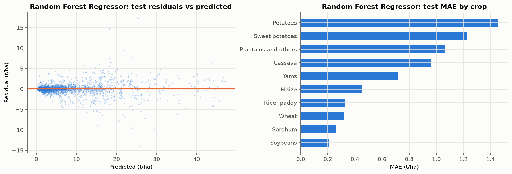

### 16.1 Prediction examples (test rows never seen during training)

| Country | Crop | Year | Actual (t/ha) | Random Forest | MLR |
|---|---|---|---|---|---|
| Greece | Rice, paddy | 2011 | 8.109 | 7.431 | 5.939 |
| Zambia | Rice, paddy | 2001 | 1.256 | 1.155 | 3.616 |
| Malawi | Plantains and others | 1999 | 4.881 | 5.934 | 10.762 |
| Central African Rep. | Yams | 1997 | 6.667 | 6.691 | 7.893 |
| Bulgaria | Rice, paddy | 2000 | 4.700 | 4.302 | 5.615 |
| United Kingdom | Potatoes | 2010 | 43.884 | 40.261 | 21.463 |
| Saudi Arabia | Potatoes | 2009 | 25.142 | 25.075 | 18.045 |
| Jamaica | Cassava | 1995 | 20.502 | 18.254 | 9.467 |

The MLR cannot tell a high-yield country (UK potatoes, 43.9 t/ha) from an average one, because it
has no country information. The Random Forest can.

**Scenario sensitivity (India, 2013 inputs, temperature raised step by step).** This shows how the
fitted model's prediction responds to temperature. It is **not** a causal climate-change projection.

| Crop | Temperature | Actual 2013 | RF prediction |
|---|---|---|---|
| Wheat | 26.79 °C (observed) | 3.154 | 3.032 |
| Wheat | +1 °C | — | 2.667 |
| Wheat | +2 °C | — | 2.681 |
| Rice, paddy | 26.79 °C (observed) | 3.607 | 3.548 |
| Rice, paddy | +1 °C | — | 3.451 |
| Rice, paddy | +2 °C | — | 3.435 |

Predictions fall at +1 °C and then level off. That flattening is a property of tree models, which
cannot extrapolate beyond the temperature range they saw in training. It is not a real agronomic
plateau.

---

## 17. Real-World Interpretation

**How different users could use a model like this (once it is retrained on local, finer-grained
data):**

| Use | How the model helps |
|---|---|
| **Crop planning** | Compare expected yields of candidate crops for a region and year before sowing. |
| **Resource allocation** | Agricultural departments can direct extension staff, seed and credit to crop–region combinations predicted to under-perform. |
| **Fertiliser / pesticide optimisation** | The MLR's positive pesticide association suggests input intensity matters. To optimise doses properly, the model would need field-level fertiliser and pesticide *rates*, which this dataset lacks. |
| **Irrigation planning** | The negative temperature association (−0.154 t/ha per °C) points to heat stress; irrigation and heat-tolerant varieties can be prioritised for the warmest regions. Real seasonal rainfall data would be needed to plan water use. |
| **Food production forecasting** | Predicted yield × planned area gives expected production, which feeds food-balance sheets and import planning. The future-years test (R² = 0.935) suggests short-horizon forecasts for known countries are feasible. |
| **Risk management** | Large gaps between predicted and actual yield flag possible shocks. Prediction-error levels by crop (e.g. MAE 1.46 t/ha for potatoes) help set insurance margins. |

**Limitations**
1. **Climate variability:** rainfall is a fixed long-term average and temperature is an annual
   country mean. The model cannot see droughts, floods, heatwaves or the timing of rain within the
   season, which are the main causes of bad years.
2. **Regional differences:** the data are national averages. A single value for India hides huge
   differences between states. Performance drops to R² ≈ 0.63 for unseen countries, so the model
   should not be applied to new regions without local data.
3. **Data quality:** temperature duplicates had to be merged; pesticides are national totals, not
   per-crop rates; FAO statistics for some countries are estimates.
4. **Missing variables:** no soil, fertiliser, irrigation, humidity, crop variety or management data.
5. **Unseen environmental conditions:** tree models cannot extrapolate (see the scenario above).
   Future climates outside 1990–2013 conditions cannot be predicted reliably.
6. **Time period:** the data end in 2013, so recent technology and climate trends are not
   represented.
7. **Association, not causation:** none of the coefficients or importances should be read as the
   causal effect of an intervention.

---

## 18. Final Results

| | Phase 1: SLR | Phase 1: MLR | Phase 2: Ridge | Phase 2: LASSO | Phase 2: Decision Tree | **Phase 2: Random Forest** |
|---|---|---|---|---|---|---|
| Test R² | 0.0374 | 0.6151 | 0.7349 | 0.7350 | 0.9598 | **0.9730** |
| Test MAE (t/ha) | 5.7294 | 3.1805 | 2.8616 | 2.8580 | 0.7868 | **0.6559** |
| Test MSE | 61.9214 | 24.7623 | 17.0531 | 17.0446 | 2.5857 | **1.7339** |
| Test RMSE (t/ha) | 7.8690 | 4.9762 | 4.1295 | 4.1285 | 1.6080 | **1.3168** |
| 5-fold CV R² | 0.0327 | 0.6054 | 0.7219 | 0.7219 | 0.9443 | **0.9651** |
| Future-years R² | 0.0061 | 0.6063 | 0.7043 | 0.7045 | 0.9035 | **0.9350** |
| Unseen-country R² | 0.0268 | 0.5891 | 0.5248 | 0.5314 | 0.5165 | **0.6269** |

**Main findings**
1. Crop type explains most of the variation in yield (η² = 0.54), followed by country (η² = 0.21).
2. Using robust inference, higher temperature is associated with lower yield (−0.154 t/ha per °C),
   pesticide intensity and the time trend with higher yield. Rainfall, as recorded, shows no reliable
   association.
3. OLS assumptions of normality, homoscedasticity and independence are violated. A log transform and
   cluster-robust SEs partly correct this. Bootstrap and CV show the estimates are stable.
4. Regularisation does not improve accuracy at this sample size, but LASSO gives a sparser and more
   transferable model.
5. The Random Forest predicts best (R² = 0.973, RMSE = 1.32 t/ha) and stays best when forecasting
   future years (R² = 0.935). Transfer to unseen countries is the main weakness (R² ≈ 0.63).

---

## 19. SDG Mapping and Justification — SDG 2: Zero Hunger

SDG 2 aims to "end hunger, achieve food security and improved nutrition and promote sustainable
agriculture". The relevant targets are **2.3** (double agricultural productivity and the incomes of
small-scale producers), **2.4** (sustainable, resilient food-production systems that adapt to climate
change) and **2.c** (timely market information to limit food-price volatility).

| # | Contribution | Demonstrated by this experiment | Potential (not demonstrated) |
|---|---|---|---|
| 1 | **Improve agricultural productivity** (Target 2.3) | Identified crop and country as the dominant drivers of yield, and a positive time trend of +0.084 t/ha per year. | Pointing extension work at the crop–region pairs with the biggest yield gaps could raise productivity. Doing so needs sub-national data and field trials. |
| 2 | **Support food security** (Targets 2.1, 2.c) | Showed that yields of known countries can be forecast for later years with R² = 0.935 (RMSE 2.23 t/ha). | Combined with planted-area data, such forecasts could warn of production shortfalls early and inform imports and buffer stocks. |
| 3 | **Help farmers make informed decisions** | Produced crop-specific predictions with known error levels (e.g. MAE 0.32 t/ha for wheat, 1.46 for potatoes). | A farm-level tool would need local soil, weather and management inputs that this national dataset does not have. |
| 4 | **Improve resource utilisation** (Target 2.4) | Found a positive association between pesticide intensity and yield, and that this signal largely overlaps with country differences. | With per-hectare fertiliser and pesticide *rates*, a similar model could help find the point beyond which more input adds little yield, cutting waste and environmental harm. |
| 5 | **Support sustainable, climate-resilient planning** (Target 2.4) | Found a robust negative association between temperature and yield (−0.154 t/ha per °C, cluster-robust p = 0.0012). | Could guide adaptation (heat-tolerant varieties, irrigation) in warming regions. Real projections need climate-scenario data and causal or process-based crop models. |
| 6 | **Transparent, reproducible evidence** | Fully reproducible open pipeline on a CC-BY dataset, with its limitations stated. | Agencies could audit and extend the method with their own data. |

**Important distinction:** this project *demonstrates* that statistical and ML models can describe and
predict national crop yields from public data with quantified accuracy. It does **not** demonstrate
any real-world improvement in productivity, food security or resource use. Those outcomes depend on
deployment with better data, on institutional adoption, and on field validation.

---

## 20. Conclusion

This project built and compared seven regression models (plus two supplementary variants) for
predicting national crop yield in t/ha. It used 13,130 cleaned FAO-based records covering 101
countries, 10 crops and the years 1990–2013.

**Phase 1** showed that one predictor is not enough (SLR test R² = 0.037). A multiple regression with
crop effects explains 61.5 % of the variance in yield. Formal diagnostics found violations of
normality, homoscedasticity and independence. The response was not to ignore them but to apply a log
transform, HC3 and country-clustered standard errors, and a cluster bootstrap. These gave stable,
honestly-sized estimates: temperature has a negative association and pesticides and the time trend
have positive associations, while the apparent rainfall effect is not reliable.

**Phase 2** used correlation analysis, RFECV and permutation importance for feature selection. All six
features were retained, with crop dominant. Ridge and LASSO reached R² ≈ 0.735, with no gain over OLS
at this sample size, though the 1-SE LASSO gave a sparser model that transfers better to new
countries. Tree ensembles captured the strong crop × country interactions. The **Random Forest was
selected as the final model** (test R² = 0.973, RMSE = 1.32 t/ha, CV R² = 0.965). It also remained
best when forecasting future years (R² = 0.935).

The most important caveat came from the extra validation: predicting yield for a **country the model
has never seen** is much harder (R² ≈ 0.63). Real deployment for SDG 2 would therefore need local,
sub-national data with actual seasonal weather, soil and input-rate variables.

---

## 21. References

1. Laktionov, I., Semenov, S., & Diachenko, G. (2026). *Dataset for Crop Yield Prediction* [Data set].
   Zenodo. https://zenodo.org/records/18761663 (CC-BY-4.0).
2. FAO. *FAOSTAT: Crops and livestock products (QCL)*. Food and Agriculture Organization of the United
   Nations. https://www.fao.org/faostat/en/#data/QCL
3. FAO. *FAOSTAT: Pesticides use (RP)*. https://www.fao.org/faostat/en/#data/RP
4. Patel, R. *Crop Yield Prediction Dataset*. Kaggle.
   https://www.kaggle.com/datasets/patelris/crop-yield-prediction-dataset
5. United Nations. *Sustainable Development Goal 2: Zero Hunger*. https://sdgs.un.org/goals/goal2
6. James, G., Witten, D., Hastie, T., & Tibshirani, R. (2021). *An Introduction to Statistical
   Learning* (2nd ed.). Springer.
7. Hastie, T., Tibshirani, R., & Friedman, J. (2009). *The Elements of Statistical Learning* (2nd ed.).
   Springer.
8. Montgomery, D. C., Peck, E. A., & Vining, G. G. (2021). *Introduction to Linear Regression
   Analysis* (6th ed.). Wiley.
9. Efron, B., & Tibshirani, R. J. (1993). *An Introduction to the Bootstrap*. Chapman & Hall.
10. Breiman, L. (2001). Random forests. *Machine Learning*, 45(1), 5–32.
11. Tibshirani, R. (1996). Regression shrinkage and selection via the lasso. *Journal of the Royal
    Statistical Society: Series B*, 58(1), 267–288.
12. Hoerl, A. E., & Kennard, R. W. (1970). Ridge regression: Biased estimation for nonorthogonal
    problems. *Technometrics*, 12(1), 55–67.
13. Breusch, T. S., & Pagan, A. R. (1979). A simple test for heteroscedasticity and random coefficient
    variation. *Econometrica*, 47(5), 1287–1294.
14. Durbin, J., & Watson, G. S. (1951). Testing for serial correlation in least squares regression II.
    *Biometrika*, 38(1/2), 159–177.
15. Shapiro, S. S., & Wilk, M. B. (1965). An analysis of variance test for normality. *Biometrika*,
    52(3/4), 591–611.
16. Duan, N. (1983). Smearing estimate: A nonparametric retransformation method. *Journal of the
    American Statistical Association*, 78(383), 605–610.
17. Pedregosa, F., et al. (2011). Scikit-learn: Machine learning in Python. *JMLR*, 12, 2825–2830.
18. Seabold, S., & Perktold, J. (2010). Statsmodels: Econometric and statistical modeling with Python.
    *Proc. 9th Python in Science Conference*.

---

## Appendix A: Reproducing the results

```bash
pip install -r requirements.txt
python src/crop_yield_pipeline.py      # writes outputs/ (about 8–10 minutes)
python src/build_notebook.py           # builds Crop_Yield_Prediction.ipynb from the script
jupyter nbconvert --to notebook --execute --inplace Crop_Yield_Prediction.ipynb
```

Environment used: Python 3.14, numpy 2.5.3, pandas 3.1.1, scikit-learn 1.9.1, statsmodels 0.15.0,
scipy 1.18.1, matplotlib 3.11.2, seaborn 0.13.2. The seed is 42 for the split, the CV folds, the
bootstrap and all models. Two consecutive runs produced identical results.

**Pipeline sections** (each is a cell in the notebook):
0. Setup
1. Load and audit
2. Clean and engineer features
3. Train/test split
4. EDA
5. SLR
6. MLR
7. Assumption tests
8. CV and bootstrap
9. Feature selection
10. Ridge and LASSO
11. ML models
12. Evaluation and robustness
13. Final model and predictions

## Appendix B: Output files
- `outputs/tables/`:
  - `descriptive_statistics.csv`
  - `yield_by_crop.csv`
  - `outlier_screening.csv`
  - `correlation_pearson.csv`
  - `correlation_spearman.csv`
  - `mlr_coefficients.csv`
  - `vif.csv`
  - `mlr_robust_standard_errors.csv`
  - `phase1_cv_folds.csv`
  - `phase1_cv_coefficients.csv`
  - `bootstrap_coefficients.csv`
  - `bootstrap_oob_performance.csv`
  - `feature_selection_summary.csv`
  - `ridge_lasso_coefficients.csv`
  - `model_comparison.csv`
  - `robustness_temporal_and_unseen_country.csv`
  - `prediction_examples.csv`
- `outputs/figures/`: figures 01–21, as referenced in the text.
